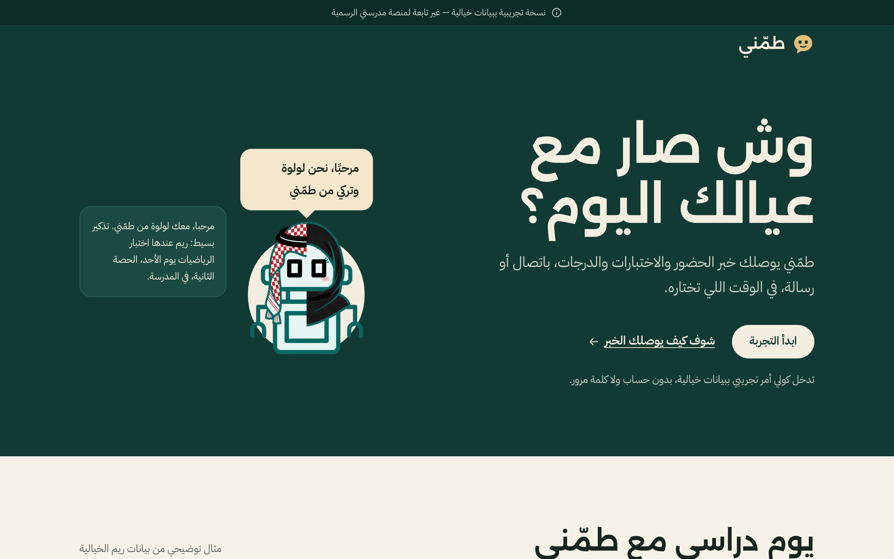
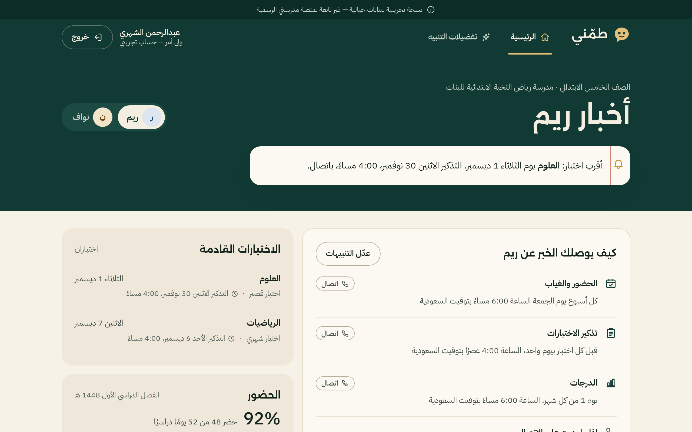
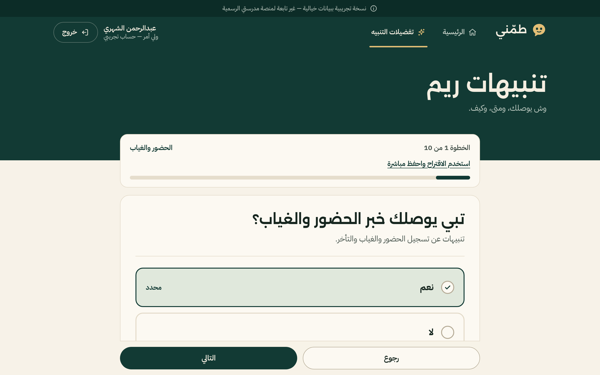
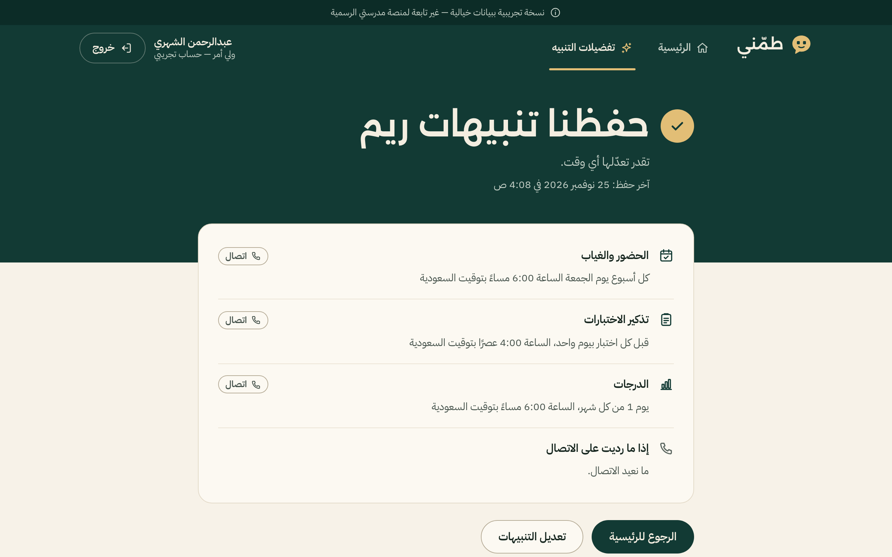

# Tammeni (طمّني)

School news for parents, by phone call or text, on their own schedule.

**Live demo: https://tammeni-demo.vercel.app/welcome**

<p align="center">
  
  
</p>

A student prototype inspired by Saudi Arabia's Madrasati school platform. Arabic, right-to-left, fictional data only. Not affiliated with Madrasati or the Ministry of Education.

## Try it (1 minute)

1. Open the [live demo](https://tammeni-demo.vercel.app/welcome) and press **ابدأ التجربة** (Start). No account needed.
2. See each child's attendance, grades and any upcoming exams. Switch between **ريم** (Reem) and **نواف** (Nawaf).
3. Press **عدّل التنبيهات** (Edit alerts), then **تعديل** (Edit) on any topic. Change an option, and press **التالي** (Next) to the end.
4. Press **حفظ التفضيلات** (Save) to see the summary of what you'll get.

The app is in Arabic. Your browser's translate option works if you'd like to follow along in English.

Everyone shares one fictional parent account, so you may see someone else's last choices.

## What it does

- **Parent dashboard**: each child's attendance, grades and any upcoming exams, read from Supabase. Row-level security limits the parent to their own children.
- **Alert choices**: per child and per topic (attendance, exams, grades): right away, a daily or weekly summary, or a custom schedule, by call or text.
- **Voice call agent**: a call from "Lulwa" gives the update, then answers questions about the child from their record. Uses OpenAI's live voice API and Twilio.
- **Demo studio** (operator only): add a school event, see which parents it reaches, preview the call or text, and send it.

In the public demo, nothing is sent automatically. Updates go out only when an operator sends them from the demo studio.

| Settings | Confirmation |
|---|---|
|  |  |

## Stack

Next.js 16, React 19, Tailwind CSS 4, Supabase (Postgres, Auth, RLS), FastAPI, OpenAI, Twilio. Hosted on Vercel and Railway.

## Run locally

Requires Node.js 20.9+ and Python 3.12+.

```bash
npm install
cp .env.example .env.local   # fill in the empty values
npm run dev                  # http://localhost:3000/welcome
```

Backend (optional, needed for calls and texts): see [`Test_AI_Agent_Upload/README.md`](Test_AI_Agent_Upload/README.md). Its provider defaults to `mock`, which sends nothing.

Checks: `npm run lint`, `npm test`, `npm run build`.

More: [deployment](docs/deployment.md) · [database](docs/database.md) · [demo studio](docs/demo-control.md) · [project report (PDF, Arabic)](docs/tammeni-report.pdf) · [presentation (Arabic)](docs/tammeni-presentation.pptx)

## Team

Built by [@mobinshamlan](https://github.com/mobinshamlan), [@shaimasaud](https://github.com/shaimasaud) and [@CODERrazan](https://github.com/CODERrazan).
